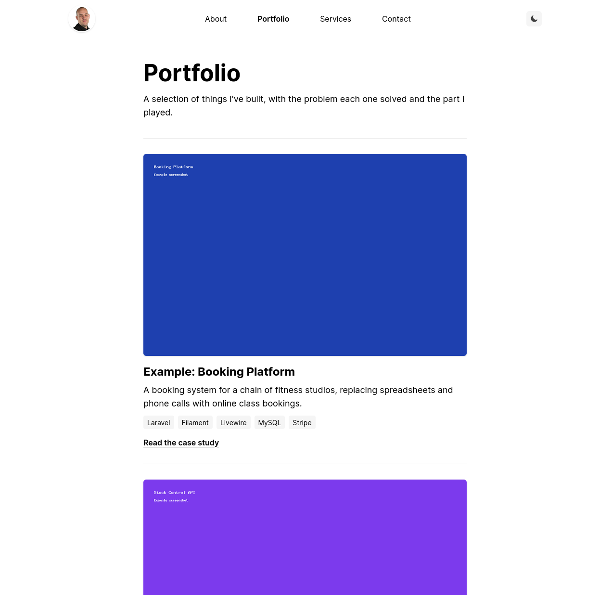
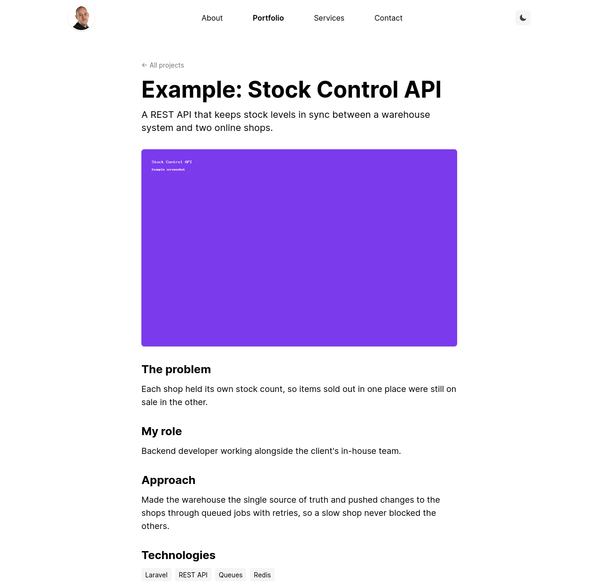

# Portfolio Frontend

[](https://github.com/MikePageDev/portfolio-frontend/actions/workflows/tests.yml)
[](https://packagist.org/packages/mikepagedev/portfolio-frontend)
[](LICENSE.md)

Public portfolio and case-study pages for Laravel. The pages render inside your own site layout.

It works on its own, or alongside [filament-portfolio](https://github.com/MikePageDev/filament-portfolio) if you want a Filament admin for your projects. You choose which packages to install; neither needs the other.





## Requirements

- PHP 8.5
- Laravel 13
- Tailwind CSS v4 on your site, because the pages are styled with Tailwind classes

## Installation

Install the package:

```bash
composer require mikepagedev/portfolio-frontend
```

Publish the config file:

```bash
php artisan vendor:publish --tag=portfolio-frontend-config
```

Then follow whichever of the next two sections fits you, and finish with [Set up your styles](#set-up-your-styles).

## With filament-portfolio

Install and set up [filament-portfolio](https://github.com/MikePageDev/filament-portfolio#installation), including its migration. There's nothing else to do: the pages find its `Project` model by themselves and show the projects you manage in your panel.

If you've changed its screenshot disk, set the same one here using `PORTFOLIO_DISK` or the `disk` config key.

## Without Filament

Publish the model and the migration into your app, then run the migration:

```bash
php artisan vendor:publish --tag=portfolio-frontend-model
php artisan migrate
```

This creates `app/Models/PortfolioProject.php` and the `portfolio_projects` table. The pages use that model automatically, so there's nothing to configure.

The model is now yours. Add projects with a seeder, Tinker or your own admin:

```php
use App\Models\PortfolioProject;

PortfolioProject::create([
    'title' => 'Booking Platform',
    'slug' => 'booking-platform',
    'summary' => 'Online class bookings for a chain of fitness studios.',
    'problem' => 'Bookings were taken by phone and on paper.',
    'role' => 'Sole developer.',
    'tech' => ['Laravel', 'MySQL'],
    'case_study' => [
        ['heading' => 'Approach', 'body' => 'Built the booking flow first.'],
    ],
    'images' => [
        ['path' => 'portfolio/booking.png', 'alt' => 'Class timetable'],
    ],
    'live_url' => 'https://example.com',
    'source_url' => null,
    'is_published' => true,
    'sort_order' => 1,
]);
```

Only `title` and `slug` are needed for a page to work, and only projects with `is_published` set to `true` are shown. Image paths are relative to the disk in the `disk` config key, and the disk has to be publicly reachable. For the default `public` disk, run `php artisan storage:link`.

To use different fields or another table, edit the published model. The pages expect these attributes: `title`, `slug`, `summary`, `problem`, `role`, `tech`, `case_study`, `images`, `live_url`, `source_url`, `is_published` and `sort_order`.

### Adding Filament later

If you install filament-portfolio after doing this, skip its migration, because the table already exists. Your published model stays in use, so the pages keep working. It takes priority over the Filament model; delete it if you'd rather use Filament's.

If neither model exists, the pages fail with an error telling you what to install or publish.

## Set up your styles

Your site's styles won't reach the pages until both of these steps are done.

### 1. Use your own layout

Set `layout` in `config/portfolio-frontend.php` to a Blade component from your site:

```php
'layout' => 'layout', // resources/views/components/layout.blade.php
```

The component needs a `$slot`, and it receives two props: `title` and a nullable `description`.

```blade
@props(['title' => null, 'description' => null])
<!DOCTYPE html>
<html>
<head>
    <title>{{ $title }}</title>
    @if ($description)
        <meta name="description" content="{{ $description }}">
    @endif
    @vite('resources/css/app.css')
</head>
<body>
    {{ $slot }}
</body>
</html>
```

The default, `portfolio-frontend::layout`, is a bare page with no styles. It's only a fallback so the package works straight after installing.

### 2. Tell Tailwind about the package's views

Tailwind doesn't scan `vendor/`, so add this to `resources/css/app.css` and rebuild your assets:

```css
@source '../../vendor/mikepagedev/portfolio-frontend/resources/views';
```

The pages use `dark:` variants, so they follow your site's dark mode.

## Pages

| URL                | Route name       | Shows                                                                              |
| ------------------ | ---------------- | ---------------------------------------------------------------------------------- |
| `/portfolio`       | `portfolio.index` | Published projects, in the order set in the panel.                                |
| `/portfolio/{slug}` | `portfolio.show` | One case study. Drafts and unknown slugs return a 404.                            |

Slugs can contain lowercase letters, numbers and hyphens.

## Configuration

| Key                         | Default                                              | Description                                                                 |
| --------------------------- | ---------------------------------------------------- | --------------------------------------------------------------------------- |
| `enabled`                   | `true`                                               | Set to `false` to turn the routes off without uninstalling the package.     |
| `prefix`                    | `portfolio`                                          | URL prefix for both pages.                                                  |
| `middleware`                | `['web']`                                            | Middleware for both pages.                                                  |
| `layout`                    | `portfolio-frontend::layout`                         | Blade component the pages render inside.                                    |
| `disk`                      | `public`                                             | Disk the screenshots are on. Set it with the `PORTFOLIO_DISK` env var.      |
| `title`                     | `Portfolio`                                          | Index page title and heading.                                               |
| `description`               | `null`                                               | Index page meta description. Left out when `null`.                          |
| `intro`                     | `null`                                               | Paragraph under the index heading. Left out when `null`.                    |
| `empty_message`             | `No projects yet.`                                   | Shown on the index page when there are no published projects.               |
| `role_heading`              | `Role`                                               | Heading above a project's role on the case-study page.                      |
| `contact_route`             | `contact`                                            | Route the contact prompts link to.                                          |
| `index_contact_prompt`      | `null`                                               | Prompt after the empty message on the index page. Left out when `null`.     |
| `case_study_contact_prompt` | `Interested in something similar? [Get in touch].`   | Prompt at the end of a case study. Left out when `null`.                    |

### Contact prompts

Prompts are plain text. Put square brackets around the words that should link to your contact page:

```php
'case_study_contact_prompt' => 'Want one of these? [Talk to us] today.',
```

Only the first pair of brackets becomes a link. HTML in the text is escaped, not rendered.

If `contact_route` is `null`, or names a route your site doesn't have, the prompts are hidden completely.

## Customising the pages

The config covers the page wording. To change anything else, publish the views and edit your own copies:

```bash
php artisan vendor:publish --tag=portfolio-frontend-views
```

They are copied to `resources/views/vendor/portfolio-frontend`. If you edit them, Tailwind needs to see those files too; `resources/views` is scanned by default.

## Testing

```bash
composer check
```

This runs the tests (`composer test`), static analysis (`composer stan`) and the code style check (`composer lint`).

## Changelog

See [CHANGELOG.md](CHANGELOG.md).

## Credits

Built by [Mike Page](https://mikepage.dev). Part of a family of independent packages that includes [filament-portfolio](https://github.com/MikePageDev/filament-portfolio).

## License

MIT. See [LICENSE.md](LICENSE.md).
